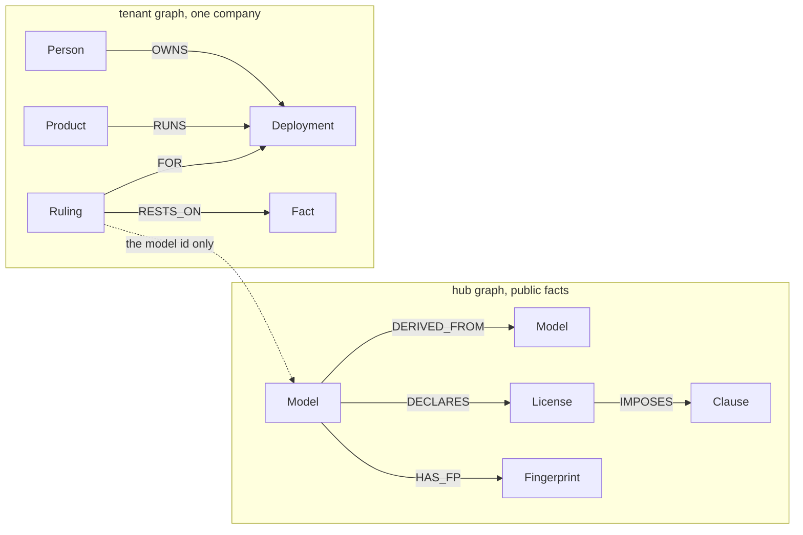

# ModelBrain

ModelBrain is the control plane for a company's AI model supply chain.

A model card on Hugging Face can say `apache-2.0` while the weights come from Llama or Gemma. The obligations travel with the weights, through every finetune, adapter, quantisation and merge, including re-uploads that name no parent. ModelBrain pulls that real ancestry into [FalkorDB](https://www.falkordb.com/), carries the licence clauses down the graph, and answers one question:

**Can this team ship this product on this model, for users in these countries, and who has to sign off?**

The answer is a verdict, the path that produced it, and a quote taken from the upstream licence. FalkorDB decides. An optional language model may only phrase the explanation. With no language-model key set, a template is used and the product still works.

Automated screening, not legal advice.

Built for [Graph Hacks: Context for AI Agents](https://www.wemakedevs.org/hackathons/falkordb) (WeMakeDevs × FalkorDB). Primary track: **Track 1, Agents That Act on Connected Data**. Also entered: **Track 2** and **Track 3**.

Repository: [github.com/bytes-as/modelbrain](https://github.com/bytes-as/modelbrain)

## What a judge should be able to see

1. **A blocked ship decision.** Ask whether a Berlin company may load `OPEA/Llama-3.2V-11B-cot-int4-sym-inc` for a commercial product. The card says `apache-2.0`. The path is `OPEA → Xkev → meta-llama/Llama-3.2-11B-Vision-Instruct`, and the Llama 3.2 community licence restricts that multimodal model for EU users. The verdict is **BLOCKED**, with the clause quoted from the official text. The same model with a US headquarters is **ALLOWED WITH OBLIGATIONS**.
2. **A fix that never reached the children** (`/replay/xkev`). On 9 July 2025 a licence discussion opened on `Xkev/Llama-3.2V-11B-cot`. 130 days later, on 16 November 2025, the author uploaded `LICENSE_llama.txt` (commit `e8c2529775`). The card still says `apache-2.0`, and none of its 9 children got the fix. One click replays that change in your sandbox: FalkorDB walks the 9 descendants and reopens the company decision that rested on one of them, with a review task for its owner.
3. **Two companies, one shared fact** (`/hidden-lineage`). `SicariusSicariiStuff/Llama-3.2-1B_Base_FP8` names no parent, but its tokenizer and config fingerprints match Meta's Llama 3.2 1B. A strict company gets CANNOT DETERMINE. Harbor (fictional) has confirmed the edge; when your sandbox company confirms it too, the edge reaches tier 3 and the strict verdict becomes ALLOWED WITH OBLIGATIONS for everyone. The hub stores a salted hash of who confirmed, not the company name.
4. **Provenance from the weights, not the card** (`/findings`). ModelBrain reads about 2 KB of each model's actual weight values with HTTP range requests and searches them in FalkorDB's vector index. In the 289 models fingerprinted for the demo, 122 match a parent their card does not declare, 82 of those trace to a licence with conditions (Llama, Gemma, Qwen research, non-commercial), and 26 also carry a different card licence. Example: `TroyDoesAI/Llama-3.1-8B-Instruct` says `wtfpl`; its sampled weights are identical to Meta's Llama 3.1 8B Instruct. Four models declare a parent the weights contradict, for example `microsoft/UserLM-8b` declares Llama 3.1 8B but matches Llama 3 8B (0.9986 vs 0.9868).

## Why FalkorDB is the engine, not a storage choice

ModelBrain is built on things FalkorDB does natively, inside one Redis-protocol process, from Cypher. Take FalkorDB away and there is no product: `/api/verdict` returns `503 GRAPH_UNAVAILABLE` (tested), and caches hold raw Hugging Face responses only, never answers.

| FalkorDB capability | What ModelBrain uses it for | Where | Measured locally |
|---|---|---|---|
| **Many graphs in one instance, `GRAPH.COPY`** | A shared `hub`, one private graph per company (`tenant_*`), and a private sandbox per visitor (`sbx_*`) cloned from a company in one command. Isolation is physical: a company's rulings are never in the hub | `tenants/sandbox.py`, `graph/db.py` | sandbox clone under 0.3 s end to end |
| **Vector index inside the graph** | Weight DNA: 1,024 sampled weight values per model in a cosine index; `db.idx.vector.queryNodes` finds the true parent, filtered by graph properties in the same query (**W2**) | `engine/dna.py`, `docs/queries.cypher` W0-W2 | |
| **Vector search + traversal + clauses in one query** | **W16**: sampled weights → nearest parent → trusted ancestry → licences → clauses, one Cypher statement | `/api/dna/inherits`, MCP `trace_weights`, verdict page | 3-6 ms |
| **Bounded variable-length traversal** (sparse-matrix engine) | **Q1** walks every ancestry path up to 6 hops, through merges, at a minimum trust tier; **D1** walks every descendant for reverse fan-out | `engine/verdict.py`, `engine/watcher.py` | Q1 7 ms; 86 descendants of Llama 3 8B Instruct in 3 ms |
| **Graph algorithms callable from Cypher** | `algo.WCC` groups re-uploads by shared file fingerprints (**R1**); `algo.pageRank` ranks relabel hubs (**A1**); `algo.betweenness` finds chokepoints a fix should start from (**A2**); `algo.labelPropagation` finds model families (**A3**); `shortestPath` / `algo.SSpaths` give a proof path or prove there is none (**A4**, **A5**) | `routes/algo.py`, `engine/resolver.py` | WCC over the hub in 4 ms |
| **Properties on edges, read inside paths** | Trust tiers, salted confirmer hashes, weight similarity and merge shares live on `DERIVED_FROM`; `reduce()` multiplies merge shares along a path (**W8**); `all(r IN relationships(p) ...)` enforces strict mode in the traversal itself | `docs/queries.cypher` Q1, P1, W8 | |
| **Fast enough for every agent call** | The MCP server answers `can_i_use`, `trace_weights` and `confirm_edge` live from the graph, and the GitHub Action gates pull requests on the same queries | `mcp_server.py`, `actions/modelbrain-check` | |
| **Persistence and Browser** | Append-only file on a volume (hub, tenants and rulings survive a restart: verified); FalkorDB Browser on port 3000 to explore the hub and a company graph | `docker-compose.yml` | |

All Cypher is in [`docs/queries.cypher`](docs/queries.cypher), copied verbatim into `services/api/app/graph/queries.py` and checked by a test.

## How a verdict is decided

The verdict is deterministic code over FalkorDB rows. It is not a language-model opinion.

1. Ingest the model and its ancestors from the public Hugging Face Hub, up to 6 hops.
2. Walk every ancestry path with query **Q1**, including every parent of a merge, and collect each licence clause.
3. Check lineage with **Q2**. If a path ends on a model that is not a known base and has no parent at the required trust tier, the lineage is incomplete.
4. Apply the clauses to the company's context: headquarters, markets, commercial use, monthly active users, whether the product redistributes weights.
5. Decide, in order: any applicable block, then an incomplete or unknown lineage, then obligations, then allowed.
6. If the card's declared licence is more permissive than what the ancestors impose, say so. The wording is "the declared licence differs from the obligations inherited from its ancestors."

Trust on each edge is a tier:

| Tier | Meaning |
|---|---|
| 0 | Weak inference, config fingerprint only |
| 1 | Strong inference, identical weights or tokenizer plus config |
| 2 | Declared on the model card or tags |
| 3 | Confirmed by two independent organisations, or by public evidence |
| 4 | Confirmed by the model author |

Default verdicts use tier 1 and above. Strict mode uses tier 2 and above, and answers **CANNOT DETERMINE** when a parent is only inferred.

Every verdict is meant to show: **Automated screening, not legal advice.**

## Weight DNA

A card's metadata can be wrong or missing; the weights cannot lie about where they came from. A fine-tune stays numerically close to its parent, and an independently trained model of the same shape does not.

1. **Sample.** For each model, read the safetensors header and two windows of 512 values (an attention output projection at a quarter of the depth, an MLP down projection at 60%) with HTTP `Range` requests: about 100-250 KB per model, never the weight file. Gated, quantised and unsupported files are recorded with their status.
2. **Search.** The 1,024 values go into a FalkorDB vector index (`CREATE VECTOR INDEX ... similarityFunction:'cosine'`). `db.idx.vector.queryNodes` finds the closest older models of the same shape (**W2**).
3. **Decide.** Similarity of 0.60 or more writes an inferred `DERIVED_FROM` edge at tier 1 (**W3**), so the parent's clauses flow into default verdicts; strict mode still needs tier 2. A declared edge is never overwritten; when the weights agree, the edge records that too.
4. **Merges.** For two-parent merges, a least-squares fit recovers the mix per window (**W7**). It is accepted only when no single parent explains the model and two parents remove at least 95% of what is left. A known 0.6/0.4 linear merge comes back as 0.600/0.402; near-identical copies and plain fine-tunes are rejected. **W8** multiplies merge shares along every path to report how much of the sampled weights trace to each root.

Measured separation: real fine-tunes score 0.98-0.9995 against their parent, heavily retrained derivatives 0.56-0.95, unrelated models of the same shape -0.013 to +0.035. Foundation models listed in `data/dna_references.json` never get weight edges, so Llama 3.1 is not "derived" from Llama 3 just because they are close.

Wording on every finding: "metadata and weights disagree" and "obligations of the parent may apply". Many cards explain their lineage in prose; the findings are about the machine-readable metadata. Each row links to both Hub pages.

## Graph data model

FalkorDB cannot query across graphs, so the application joins them. The **hub** answers "what does this model inherit?" A **tenant** graph answers "who uses it, under which context, and what did we decide?" One FalkorDB instance holds all of them.



The hub never stores which tenant uses which model. A confirmation arrives as a salted hash on the edge.

### Hub

| Node | What it stores |
|---|---|
| `Model` | Hub id, commit sha, declared licence, pipeline, whether it is a known root, file and notice flags |
| `License` | Normalised key such as `llama3_2`, `apache-2.0`, `gemma` |
| `Clause` | Effect (`BLOCK`, `OBLIGATION`, `NEEDS_COUNSEL`), the rule that decides when it applies, and a quote extracted at runtime |
| `Fingerprint` | Weights sha256, tokenizer hash, or config fingerprint |
| `Model.dna` | 1,024 sampled weight values (`vecf32`) in a cosine vector index, with the shape class and sampling status |
| `FanOut` | Audit record of one reverse fan-out: what changed, descendants walked, decisions reopened |
| `Sandbox` | A visitor sandbox: name, template, expiry and a hash of its token |
| `Snapshot` | One observed revision. Append-only |
| `Discussion` / `Outcome` | A Hub discussion and what happened after it |

| Relationship | Meaning |
|---|---|
| `DERIVED_FROM` | Child to parent. Carries relation, source, tier, confidence, evidence, and confirmer hashes |
| `DECLARES` | The licence the card declared at a commit sha |
| `IMPOSES` | The clauses that licence imposes |
| `HAS_FP` | A file hash attached to a model |

### Tenant

Each company is a graph named `tenant_<slug>`. A visitor sandbox is `sbx_<id>`, copied from a tenant template with `GRAPH.COPY` and deleted after two hours.

| Node | What it stores |
|---|---|
| `Company`, `Team`, `Person` | The fictional organisation. Names are labelled "(fictional)" |
| `Product`, `Deployment` | What ships, on which model, pinned to which commit |
| `Ruling` | ALLOWED, ALLOWED_WITH_OBLIGATIONS, BLOCKED, or CANNOT_DETERMINE. Never edited in place |
| `Fact` | The model shas, licences, clauses and edge tiers the ruling relied on |
| `Event` | Reopened, superseded, approved, rejected, or an edge confirmation |
| `Task` | Review, approve, or confirm, handed from one agent to a person |
| `Playbook` | The steps an agent follows for that task kind |

A changed answer is a new ruling that `SUPERSEDES` the old one.

Demo tenants, both fictional: **Kestrel Analytics GmbH** (Germany) and **Harbor Apps Inc.** (United States).

### Memory (Track 2)

| Kind | Where it lives | Example query |
|---|---|---|
| **Episodic** | `Ruling` and `Event` history on the tenant graph | `MATCH (r:Ruling)<-[:ON]-(e:Event) RETURN r.verdict, e.kind, e.at ORDER BY e.at DESC LIMIT 20` |
| **Semantic** | Hub facts: models, licences, clauses, fingerprints | `MATCH (m:Model)-[:DECLARES]->(l:License) RETURN m.id, l.key LIMIT 20` |
| **Procedural** | `(:Playbook)` nodes per task kind, linked by `(Task)-[:FOLLOWS]->(Playbook)` | `MATCH (t:Task)-[:FOLLOWS]->(p:Playbook) RETURN t.kind, t.state, p.steps` |

Conversation turns for MCP and web checks with a tenant are stored as `(Conversation)-[:HAS_TURN]->(Turn)` and `(Turn)-[:PRODUCED]->(Ruling)` when a ruling is written.

## Queries and algorithms

Every query the product depends on is in [`docs/queries.cypher`](docs/queries.cypher) and copied into `services/api/app/graph/queries.py`. Paths are bounded (`*0..6` or `*1..6`). Reads use `ro_query`. Writes `MERGE` on ids.

| Query | What it answers |
|---|---|
| **Q1** | Every licence and clause inherited along every ancestry path, at a minimum trust tier. This is the verdict. |
| **Q2** | The top of each path. A top that is not a known base model means the lineage is incomplete, so the honest answer is CANNOT DETERMINE. |
| **Q3** | Nodes and edges for the lineage picture, with duplicate edges removed. |
| **R1** | Connected components (`algo.WCC`) over models that share a file fingerprint. This unmasks a re-upload that names no parent. |
| **D1** | Every descendant of a model whose card just changed, up to 6 hops downstream. |
| **P1** | Add a salted hash of a confirming organisation. Two distinct hashes raise the edge to tier 3. The hub still does not learn the organisation's name. |
| **T3** | Active rulings in one company that rest on a model which just changed, and the person who owns that deployment. |
| **A1** | PageRank over lineage, kept to models whose declared licence differs from what they inherit. These are the relabel hubs. |
| **A2** | Betweenness. A fix on a high-scoring model reaches the most descendants. |
| **A3** | Label propagation. Model families in the lineage graph. |
| **A4** | Shortest derivation path from a model to a given base, or proof that no path exists. |
| **W2** | Weight DNA: nearest older models of the same shape in the FalkorDB vector index. |
| **W3** / **W7** | Write an inferred parent edge from the weights, or two merge edges with their shares. Declared edges are never changed. |
| **W4** / **W5** | Models whose weights match a parent the card does not declare; and declared parents the weights contradict. |
| **W8** | Weight exposure: the product of merge shares along every path to each root. |
| **T4** / **X1** | Reopen a ruling with an event and a review task for its owner; record the fan-out run. |
| **W16** | From sampled weights to licence clauses in one query: vector search, nearest parent, trusted ancestry, licences, clauses. |

FalkorDB is load-bearing. If it is stopped, `/api/verdict` is specified to return `503 GRAPH_UNAVAILABLE` rather than an answer from a cache. Caches hold raw Hugging Face responses only.

### Explore in FalkorDB Browser

With the local stack running, open [http://localhost:3000](http://localhost:3000). Select the `hub` graph and run:

```cypher
MATCH (c:Model)-[e:DERIVED_FROM]->(p:Model)
RETURN c.id, e.tier, e.relation, p.id
LIMIT 50
```

That is the ancestry the verdict walks. A tenant trace, once rulings exist, is:

```cypher
MATCH (r:Ruling)-[:RESTS_ON]->(f:Fact)
OPTIONAL MATCH (e:Event)-[:ON]->(r)
RETURN r.id, r.verdict, f.model_id, f.sha, e.kind
LIMIT 50
```

Run the second query in `tenant_kestrel` or `tenant_harbor`, not in `hub`.

## Architecture

```
Browser (Next.js)  ----HTTPS---->  FastAPI
Coding agent       ----MCP------>  /mcp
                                      |
                                      | Cypher
                                      v
                                   FalkorDB
                          hub + one graph per company
                          + a sandbox graph per visitor
```

| Piece | Role |
|---|---|
| `services/api` | Python 3.12, FastAPI. Verdicts, ingest, tenants, MCP |
| `apps/web` | Next.js App Router. The check page, companies, replay, eval |
| FalkorDB | The only database. Docker image `falkordb/falkordb` |
| `actions/modelbrain-check` | GitHub Action: scans a repo for Hugging Face model ids, asks `/api/ci/check`, writes a job summary, fails the pull request when a model is BLOCKED |

Agents are workers with narrow tools: Scout ingests, Resolver infers hidden parents, Auditor writes rulings, Watcher reopens them when an upstream sha changes, Notifier drafts a discussion, Publisher promotes a confirmed edge. They hand work to each other through `Task` nodes. Nothing is posted to Hugging Face unless an authenticated person clicks Approve, and only to repos on `HF_POST_ALLOWLIST`.

Licence quotes are not stored in this repository. The clause loader fetches the official text at runtime and extracts the quote with a locator. A clause it cannot extract is `NEEDS_COUNSEL`.

## Tracks

- **Track 1, primary.** Multi-hop ancestry, graph algorithms and vector search as tools, weight DNA that finds parents the card does not declare, an MCP server (`can_i_use`, `trace_weights`, `confirm_edge`, ...) a coding agent calls before it adds `from_pretrained`, and an explanation that cites the path and the clause.
- **Track 2.** One graph per company, rulings remembered across sessions, tasks handed from the watcher to the owner.
- **Track 3.** Each deployment has an owner, each ruling points at the commit and the clause that justified it, and an upstream change reopens the ruling.

## Run locally

You need Docker, and Node.js 22 for the web app.

```bash
cp .env.example .env
# Set ADMIN_TOKEN and PUBLISHER_SALT. HF_TOKEN is optional.
# A missing HF_TOKEN still boots; Hub calls are anonymous and rate-limited.

docker compose up --build
```

| URL | What |
|---|---|
| http://localhost:8000/api/health | API. `falkordb` should be `"up"` |
| http://localhost:3000 | FalkorDB Browser |
| http://localhost:3001 | Web app, after the next command |

The Browser owns port 3000, so the web app uses 3001:

```bash
cd apps/web
npm install
npm run dev -- -p 3001
```

If something else is already listening on port 6379, publish FalkorDB on another host port in a `docker-compose.override.yml`. The API container still reaches it at `falkordb:6379` on the Compose network.

Common tasks are `make` targets:

| Target | What |
|---|---|
| `make up` / `make down` | start or stop FalkorDB and the API |
| `make web` | the web app on port 3001 |
| `make test` | API tests against the FalkorDB service container |
| `make smoke` | 13 end-to-end checks (verdicts, lineage, replay, weight DNA, MCP, pages) |
| `make eval` | re-run the frozen eval into `eval/report.json` |
| `make crawl` | fingerprint the foundation references and demo findings |
| `make demo-reset` | put the compounding demo back to its start state |
| `make reset` | re-seed the fictional tenants (never the hub) |
| `make export` / `make import` | snapshot or restore the graphs with `DUMP`/`RESTORE` |

A fresh FalkorDB starts with only the fictional companies. Either run `make crawl` (about 25 minutes with `HF_TOKEN`) or restore an export.

## Deploy

One Railway project with three services: FalkorDB (private networking only, a volume at `/var/lib/falkordb/data`, `requirepass`), the API (`services/api/Dockerfile`, listens on `$PORT`) and the web app (`apps/web`). Step by step, including seeding production from a local export in seconds and the smoke test: [`docs/DEPLOY.md`](docs/DEPLOY.md). Judge-day operations: [`docs/RUNBOOK.md`](docs/RUNBOOK.md).

## What is in the repo

| Path | What |
|---|---|
| [`docs/queries.cypher`](docs/queries.cypher) | Every Cypher query |
| [`docs/API.md`](docs/API.md) | HTTP and MCP contract |
| [`docs/FLOWS.md`](docs/FLOWS.md) | Runtime flows, including failures |
| [`docs/UI.md`](docs/UI.md) | Pages and copy |
| [`docs/GOALS.md`](docs/GOALS.md) | The build list and acceptance tests |
| [`docs/EXPLAINER.md`](docs/EXPLAINER.md) | Two-minute explanation of the graph |
| [`docs/DEMO.md`](docs/DEMO.md) | The 3-minute demo script |
| [`docs/DEPLOY.md`](docs/DEPLOY.md) / [`docs/RUNBOOK.md`](docs/RUNBOOK.md) | Deploying on Railway; judge-day operations |
| [`docs/ADDENDUM_WEIGHT_DNA.md`](docs/ADDENDUM_WEIGHT_DNA.md) | The weight DNA specification and its evidence |
| [`actions/modelbrain-check`](actions/modelbrain-check) | GitHub Action that gates pull requests |
| [`data/`](data/) | Clause locators, EU country list, roots, demo tenants. No licence prose |
| [`services/api`](services/api) | The API |
| [`apps/web`](apps/web) | The web app |
| [`eval/`](eval/) | Frozen eval: 40 models, 160 cases (default and strict). Drafted by an agent on 18 Oct 2026 at the owner's request, before the clause engine; reviewed by a person. Latest run: false ALLOW 0, default accuracy 0.85 |

## Licence

Noncommercial use is free under the [PolyForm Noncommercial License 1.0.0](LICENSE).

Commercial use needs a royalty-bearing licence from the copyright holder. Read [COMMERCIAL.md](COMMERCIAL.md) and email [arunsin997@gmail.com](mailto:arunsin997@gmail.com).

Copyright 2026 Arun Singh.

## Built with AI assistance

Claude was used for research and for the product specification. Cursor implemented the first milestones of the repository. On 18 October 2026 Claude (Claude Code) took over implementation: weight DNA, the reverse fan-out and replay, compounding, and fixes to ingest and sandboxes. The eval labels in `eval/labels.json` were drafted by an agent and are reviewed by a person. The graph, not a language model, decides each verdict.

## Wording

ModelBrain says "the declared licence differs from the obligations inherited from its ancestors", "this use may not be permitted", and "needs counsel". It does not say a named person or company is violating anything. Demo companies and people are fictional.
